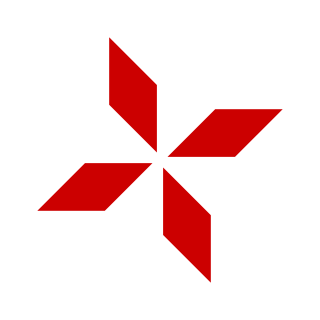
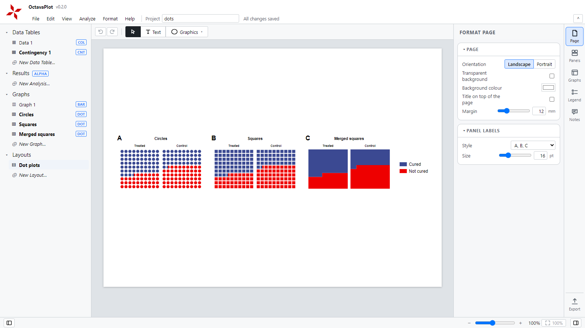
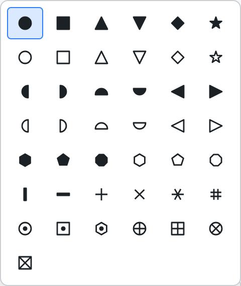
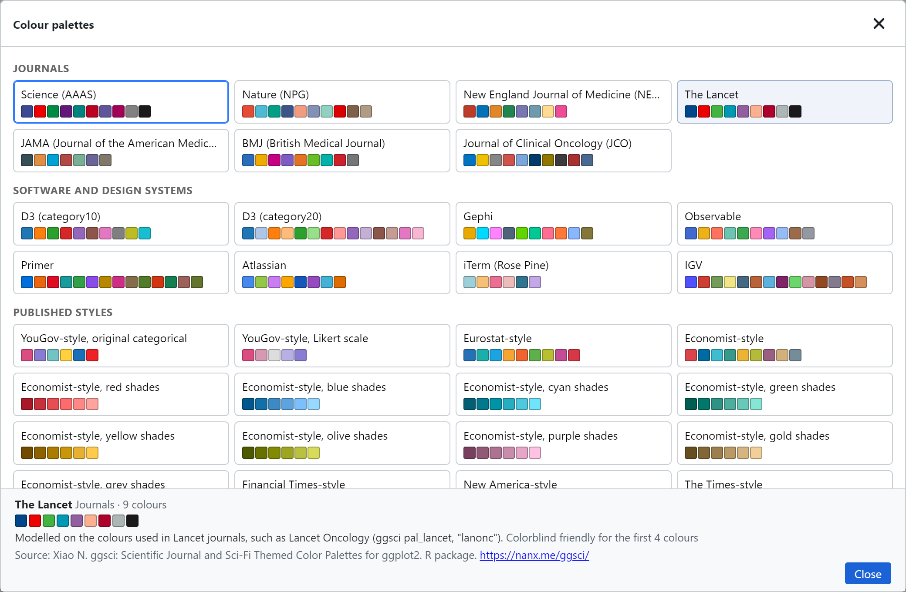

<p align="center">
  
</p>

<h1 align="center">OctavaPlot — v0.3</h1>

<p align="center">
  <a href="https://octava.be/"></a>
  <a href="https://www.buymeacoffee.com/itrus"></a>
</p>

<p align="center">
  <a href="https://github.com/itrus/OctavaPlot/actions/workflows/deploy.yml"></a>
  <a href="LICENSE"></a>
</p>

<p align="center">
  <b>Tech:</b>
  
  
  
  
  
  
  
</p>

OctavaPlot is a React + TypeScript + Vite + D3 app, with statistical tests to be calculated in R through plumber2, for editing data tables (column, XY, grouped, contingency and survival) and the charts drawn from them: 34 chart types, from dot plots, bars, box plots and violins to XY, survival, heat map and pie charts. Tables, charts, layouts and files work offline after `npm install`; statistical tests will be calculated by the R server at octava.be (in progress).

<h3 align="center">▶ <a href="https://octava.be/">Open OctavaPlot in your browser: https://octava.be/</a></h3>

## Why OctavaPlot

- **Your own copy.** GPL v3: run it, copy it, change it and share it. The whole source is in this repository, with no licence fee, account or subscription.
- **Runs on Linux, Windows and macOS.** In a modern browser, or offline after `npm install` (statistical tests in R will need a connection to octava.be).
- **Everything is live.** Graphs follow the table, results are recalculated from it, and linked graphs follow their source. Changing a stroke width on a graph of 100 000 observations showed on screen after 114 ms; a title edit on a normal graph, after 20 ms.
- **Files you can read.** A `.oplot` project is plain JSON that any text tool can open and diff.
- **Data stays local, except for statistics.** Tables, graphs and project files stay in your browser and on your computer. When statistical tests arrive, only the values of a test you run will be sent to the R server at octava.be; until then nothing is sent (About → R only asks whether the server answers).
- **Statistics with R (in progress).** Statistical tests will be calculated in R through a plumber2 web API; curve fits stay in the browser.

**One screenshot, three advantages.** The numbers below match the parts of the picture.

<p align="center">
  
</p>

1. **The chart stays in view.** Settings are in a side panel (right of the picture) next to the chart, not in windows that cover it.
2. **10 × 10 dot plot with circles, squares or merged squares.** 100 dots for each group, filled row by row (plots A, B and C). Set the dot size to 1 and the squares touch and merge into one block (plot C).
3. **Automatic panel labels and legend.** In a page layout the labels (A, B, C, a, b, c, I, II, III or 1, 2, 3) and one master legend merged from the graphs' own legends are made for you and follow the graphs (letters A to C, legend right of the plots).

Also:

- **Symbol picker.** 28 symbol shapes, solid or open, in one grid, including four half circles (left, right, up, down):

<p align="center">
  
</p>

- **59 nice colour palettes** (journals, software, published styles) and 27 heat-map gradients, with colour-blind checks. Point at a palette to see all its colours, its source and how well it works for colour-blind readers:

<p align="center">
  
</p>

## Contents

1. [Run](#run)
2. [Project file (.oplot)](#project-file-oplot)
3. [Structure of the source](#structure-of-the-source)
4. [Documentation](#documentation)
5. [Compliance note](#compliance-note)
6. [Status and verification](#status-and-verification)
7. [Version history](#version-history)
8. [To do](#to-do)
9. [License](#license)

## Run

Requires Node.js 26.

```bash
npm install
npm run dev       # development server
npm run build     # type-check (strict) + production build
npm test          # unit tests (vitest)
npm run perf      # timings of the performance table, taken in the browser on the production build (node_modules/.cache/perf.json)
npm run e2e       # browser tests (Playwright, in the installed Google Chrome; starts its own dev server on port 5199)
npm run typecheck # type-check only (no unused locals or parameters allowed)
npm run knip      # unused files, exports and dependencies
```

## Project file (.oplot)

A project is saved as a `.oplot` file: UTF-8 JSON, not compressed, signed or encrypted, so it can be read and diffed with any text tool. The envelope is `{ "format": "octavaplot-project", "version": 1, "project": { ... } }`. Autosave in the browser stores the same text.

- **Versions.** Version 1 is the only one written so far. Files that earlier builds wrote are brought to the current shape by the steps in `src/state/migrate.ts` (tested against three real old files); a newer version is refused with a message saying so.
- **What is refused.** A file that is not named `*.oplot`, is over 64 MB, is not UTF-8 JSON, has another format or version, or holds a damaged project. The open project is kept.
- **What is repaired.** A value of the wrong type is reset to its default and listed in the status bar; excluded values, annotations and reference lines are checked field by field.
- **Units.** Lengths in `...Pt` keys are true points; the chart size is in px.

The full description (contents, units, what is checked, what is not stored, privacy) is in [docs/FILE_FORMAT.md](docs/FILE_FORMAT.md); a small example is [docs/example.oplot](docs/example.oplot).

## Structure of the source

`src/` holds the app, its unit tests and the logo (`src/assets/`), `e2e/` the browser tests, `docs/` the specifications and `scripts/` helpers. The layers, the folders and the drawing rules are in [docs/ARCHITECTURE.md](docs/ARCHITECTURE.md).

## Documentation

- [User guide](docs/GUIDE.md): table and chart types, what each chart type can do, chart reference, analyses, linked graphs, layouts and export, editing, calculation settings and colour palettes.
- [Project file](docs/FILE_FORMAT.md): the `.oplot` format, what is checked on opening, privacy.
- [Source structure](docs/ARCHITECTURE.md), [calculation contracts](docs/calculation-contracts.md), [roadmap](docs/ROADMAP.md), [backlog](docs/BACKLOG.md) and [change log](docs/CHANGELOG.md).

## Compliance note

Row titles, data-set names and values are stored unencrypted in the browser (`localStorage` autosave) and in saved `.oplot` files. When statistical tests are added, the values of a test will be sent to the R server only when you run it. Autosave can be switched off in Settings; switching it off deletes the copy kept in the browser (after asking). A project saved as a file stays wherever the file is kept.

## Status and verification

- **Known limits.** Reference lines are not drawn on pie charts or heat maps; a graph has one data layer (a file with more is read with a note and only the first is kept); the look per part is not offered for pie charts, heat maps and stacked bars.
- **What was checked.** [docs/BACKLOG.md](docs/BACKLOG.md) says, for each feature, whether it was tested in code and whether it was also tried in a browser; a feature that does not say "Browser" was not. `npm run e2e` runs the browser tests in Chrome. Only Edge 142 and Chrome have been used; Firefox and Safari are not verified.
- **Where the rest is.** To do, known issues and gaps: [docs/BACKLOG.md](docs/BACKLOG.md). Decisions, architecture rules and performance targets: [docs/ROADMAP.md](docs/ROADMAP.md). What changed and when: [docs/CHANGELOG.md](docs/CHANGELOG.md).

## Version history

| Version | Dates | Commits | Code | What it is |
|---|---|---|---|---|
| v0.1 | 22 Oct – 14 Nov 2026 (to f978e1b) | 63 | 66.8 kLoC (40.0 source + 26.8 tests) | From an empty repository to the full editor: 5 table types, 57 gallery graphs (34 chart types), curve fits in a Web Worker, `.oplot` files, layouts, SVG/PNG/PDF export, forest plots, heat maps, shapes and rich text. 63 browser tests |
| v0.2 | 14 – 26 Nov 2026 (f978e1b to eb40b0e) | 29 | 71.8 kLoC (43.7 source + 28.1 tests) | Audit fixes with regression tests, symbol picker, palette and gradient pickers, export panels, new-graph and layout dialogs, axis and chart defaults, a shorter README with the details in `docs/`; highlights, label angles, reference-line options and one-column pies; review fixes and 65 fewer source files; deployment to octava.be; the version label with the build number; plots lined up in layouts; copy and paste of texts and shapes. 63 browser tests |
| v0.3 | from 26 Nov 2026 (in progress) | from eb40b0e | not counted yet | Statistical tests in R through plumber2 on the VPS. First step: the connection (Info → R shows whether the R server answers) |

What changed and when: [docs/CHANGELOG.md](docs/CHANGELOG.md). Day-by-day history of v0.1: [docs/ROADMAP.md](docs/ROADMAP.md#version-01-22-october-to-14-november-2026).

## To do

1. **Beta-testing.** Release the app to a small group and collect defects and requests.
2. **Statistics with R.** R is reached through a **plumber2** server (webR, R inside the browser, is no longer planned).
3. **Tooling.** Choose a few lint rules and try the stricter compiler flags (`knip` is in place since 23 Nov 2026).

The full list, with what has not yet been tried in a browser and the known issues, is in [docs/BACKLOG.md](docs/BACKLOG.md).

## License

Released under the [GNU General Public License v3.0](LICENSE).
